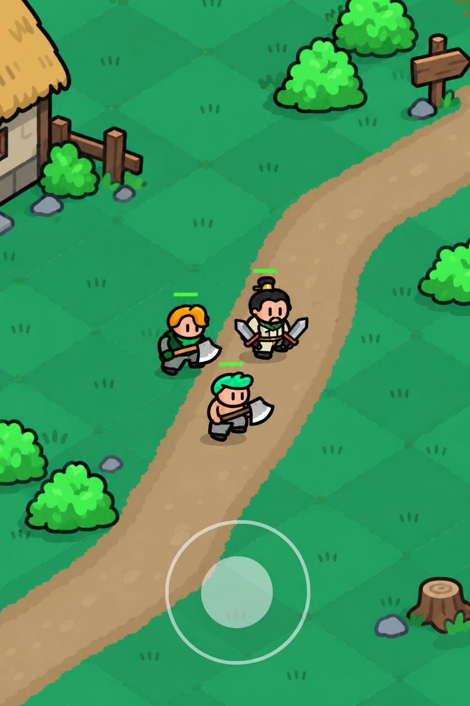
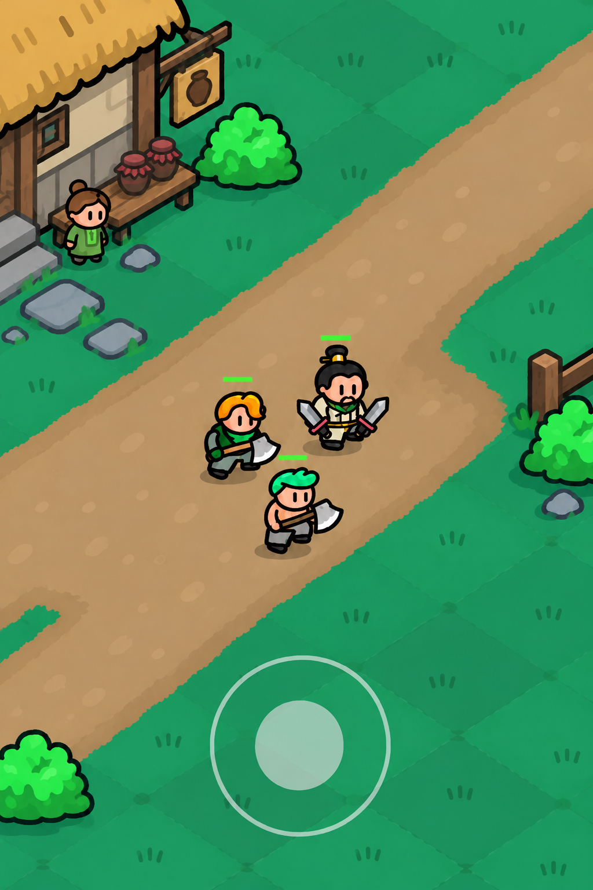
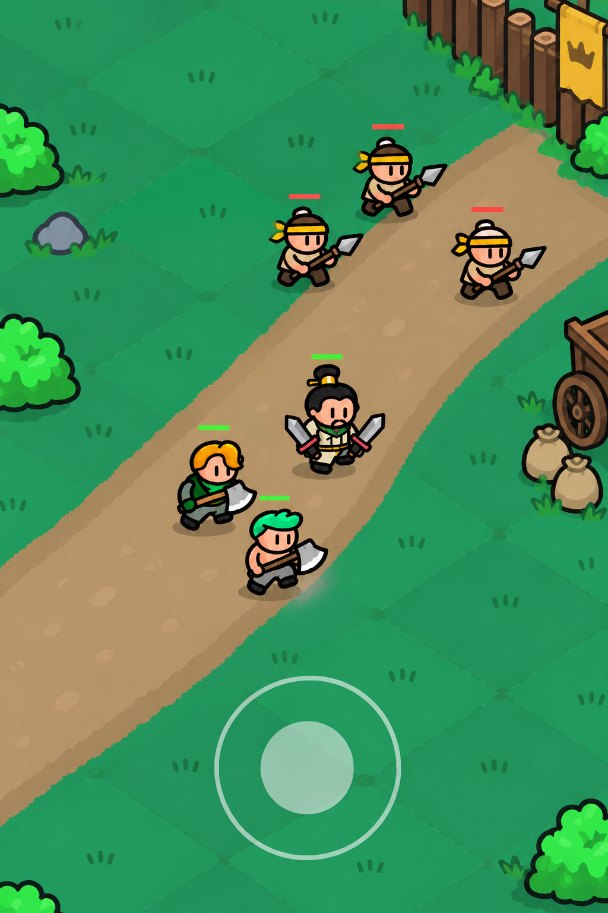
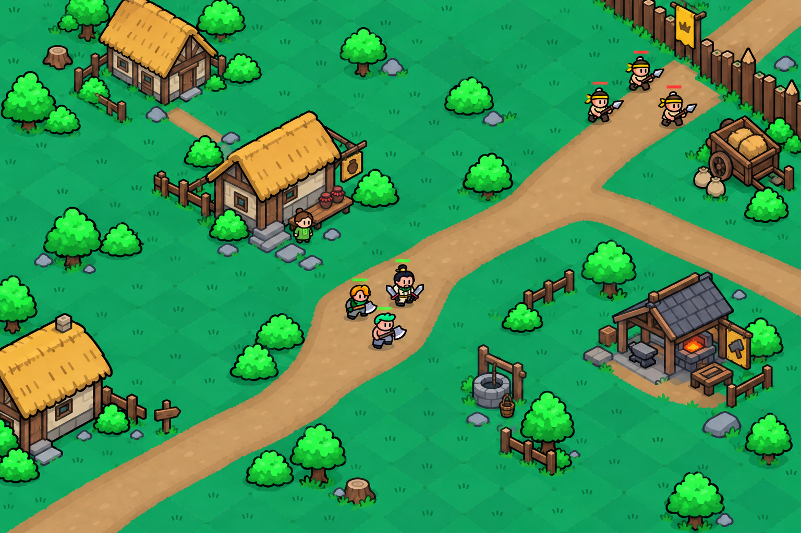
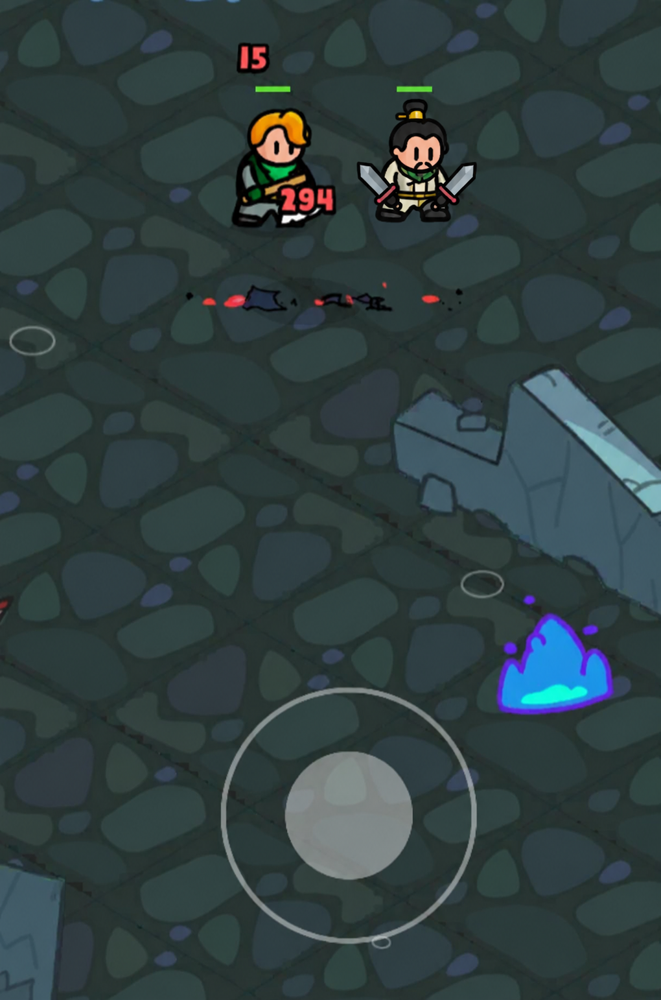
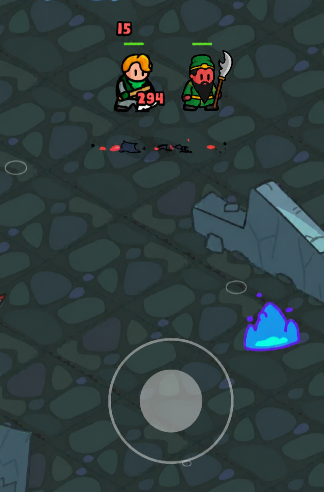
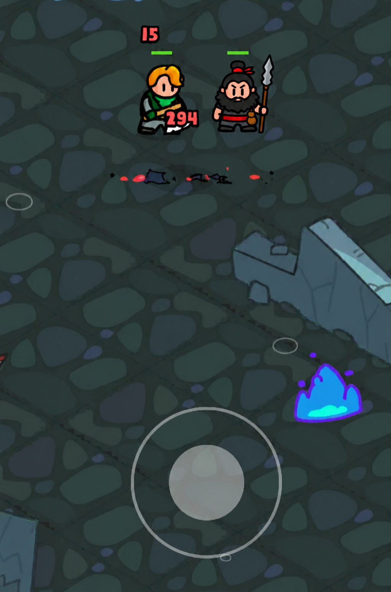

# 삼국지 용병단 기본 스타일

승인일: 2026-10-23 (Asia/Seoul)

## 원작 근거 자료

[원작 스크린샷 7장 및 출처·관찰 기록](references/original-game/README.md)을 함께 보관한다. 원작 자료는 표현을 판단하는 근거이고 아래 승인 7컷은 삼국지 프로젝트에 적용한 기준이다. 작업 전 관련 원작 자료와 승인 이미지를 모두 직접 확인한다. 원작 표현을 교정하는 생성에는 원작 자료도 시각 참조로 전달한다.

세로 2:3, 영웅 높이 약 10~12%, 삼국지 시설 배치 등은 이 프로젝트의 승인 선택이며 원작 전체에서 측정·검증된 고정 규격이 아니다. 원작 자료와 승인 이미지가 다르면 관찰 사실과 승인 선택을 구분하고 임의로 기준을 교체하지 않는다.

## 기준 이미지

사용자가 승인한 아래 7컷을 기본 스타일의 시각적 기준으로 삼는다. 원작 게임 스크린샷 자체가 아니라 원작을 참고해 생성·편집한 확장판 목업이다. 2026-10-23에 전체 조감도와 세 장수 캐릭터 장면까지 모두 기본 스타일로 승인했다.

1. [마을 입구 이동](references/samguk-base-style/01-village-entrance.png)
2. [주막 앞 이동](references/samguk-base-style/02-tavern-road.png)
3. [황건군 초소 접근](references/samguk-base-style/03-yellow-turban-outpost.png)
4. [마을 전체 조감도](references/samguk-base-style/04-village-overview.png)
5. [유비 — 기존 영웅 옆](references/samguk-base-style/05-liu-bei.png)
6. [관우 — 기존 영웅 옆](references/samguk-base-style/06-guan-yu.png)
7. [장비 — 기존 영웅 옆](references/samguk-base-style/07-zhang-fei.png)

참조 우선순위: 캐릭터 외형·비율·선 표현은 05~07번, 플레이 카메라와 마을 지형은 01~03번, 전체 공간 배치와 축소 시점은 04번을 사용한다. 캐릭터 컷의 던전 배경은 마을 배경 기준이 아니다. 각 작업에 관련된 이미지를 직접 열어 확인하고 생성 도구에도 전달한다.

## 표현 규칙

- 굵은 검은 외곽선, 단순한 2D 색면과 제한된 명암. 실사, 3D 렌더, 회화적인 재질, 복잡한 갑옷 장식을 피한다.
- 큰 머리, 짧은 몸과 팔다리, 작은 발, 검은 세로선 눈. 신규 영웅도 기존 영웅과 같은 선 두께·비율·디테일 수준을 따른다.
- 유비는 검은 상투와 작은 금색 장식, 작은 콧수염, 아이보리 옷과 녹색 목깃, 짧고 넓은 쌍검으로 식별한다. 원작 금발·초록 머리 도끼 영웅과 자연스럽게 어울려야 한다.
- 관우는 붉은 얼굴, 녹색 두건과 옷, 단순한 검은 긴 수염, 회색 초승달 날의 청룡언월도로 식별한다. 수염과 무기는 큰 단순 형태로 표현한다.
- 장비는 붉은 머리띠, 검은 상투, 넓고 덥수룩한 수염, 짙은 옷과 붉은 허리띠, 물결형 창날의 장팔사모와 작은 술병으로 식별한다. 약간 넓은 체형이어도 기존 영웅과 높이·디테일 수준을 맞춘다.
- 초록 지면에 은은한 마름모 색 구획, 넓은 베이지색 흙길, 덩어리 형태의 밝은 초록 수풀, 드문 풀잎과 돌을 사용한다.
- 비스듬히 내려다보는 평행 투영에 가까운 게임 시점을 유지한다. 지평선·강한 원근·영화적 조명을 사용하지 않는다.
- 삼국지 요소는 초가·목조 건물, 술독, 곡식 포대, 목책, 황색 두건과 깃발 등으로 표현한다.

## 기본 플레이 카메라

- 승인 이미지처럼 세로 2:3 화면. 후속 구현의 실제 화면비가 지정되면 그 비율을 따른다.
- 카메라는 파티를 따라가며 마을의 부분 장면을 보여준다. 영웅 몸 높이는 화면 높이의 약 10~12%를 출발 기준으로 삼고 승인 이미지와 시각적으로 비교한다.
- 영웅 주변 이동·전투 공간을 넓게 비운다. 건물은 가장자리에서 일부만 보이며 화면 밖으로 이어진다.
- 소품은 벽·울타리 주변에 묶고 길과 파티를 가리지 않는다. 디테일은 용도가 읽히는 소품으로 보강한다.
- 이동 동작과 진행 방향이 읽혀야 한다. 적은 같은 스프라이트 표현으로 만들고 녹색 아군/붉은 적 체력 바를 사용한다.
- 승인 목업에는 체력 바와 반투명 조이스틱만 있다. 이것이 원작 전체 UI의 완전한 명세는 아니다. 추가 HUD가 필요하면 실제 원작 자료를 확인한다.

## 전체 마을 조감도 기준

사용자는 2026-10-23에 승인된 부분 장면 기준으로 마을 전체 화면을 요청했고, 유닛이 작아져도 좋다고 명시했다. 그 결과인 04번 이미지도 기본 스타일로 승인되었다. 기본 플레이 장면과 전체 조감도는 목적이 다른 두 카메라 기준이다.

- 전체 화면은 공간 연결을 검토하는 별도 지도/조감도 산출물이다. 기본 플레이 카메라를 대체하지 않는다.
- 입구 → 주막 앞 길 → 황건군 초소가 하나의 연속된 길로 연결되도록 한다.
- 가까운 컷에서 보인 건물·소품·지형의 모양과 상대 크기를 유지하고 카메라만 뒤로 물린다.
- 집들을 중앙에 밀집시키지 않고 넓은 길, 빈 풀밭, 건물 사이 공간을 유지한다. 유닛과 환경을 같은 비율로 축소한다.
- 지도에는 플레이용 조이스틱이나 임의의 HUD를 붙이지 않는다.

## 생성 및 검수

내장 이미지 생성 도구로 제작했다. 다음 작업도 승인 PNG를 직접 시각 참조로 넣는다. 텍스트 설명만으로 화풍을 재구성하지 않는다.

공통 프롬프트 요약: 원작과 승인 컷에 맞춘 평면 2D 게임 표현, 굵은 외곽선, 세로선 눈과 짧은 몸, 동일한 영웅 크기, 가까운 추적 카메라, 넓은 흙길과 초록 지면, 가장자리에서 잘리는 건물, 여유 있는 보행 공간, 임의 UI 금지. 장면별 변경은 입구/주막/초소의 부분 환경과 이동 상황으로 제한한다.

검수 시 승인 컷과 캐릭터 크기, 선 두께, 지면 색, 소품 밀도, 시점을 비교한다. 전체 지도 요청이면 축소 배율과 장면 연결성을 별도로 확인한다. 새 결과는 사용자가 승인하기 전까지 기본 스타일을 대체하지 않는다.

## 작업 상태 — 2026-10-23

현재 확정 범위는 위 승인 7컷의 캐릭터 외형, 마을 부분 장면, 전체 조감도다. 공격·스킬 모션은 확정하지 않았다. 사용자 요청으로 모션 시안·전투 시뮬레이션·관련 제작 자료를 삭제하고 제작을 보류했다.

원작 스킬의 발동 조건과 동작 단계, 효과 궤적·범위·타이밍, 적의 접근·공격·피격 반응을 충분히 분석한 뒤 사용자의 재개 요청에 따라 작업한다. 정지 화면만으로 모션을 추측해 만들거나 폐기된 시안의 스킬 설정·수치를 확정 사양처럼 계승하지 않는다. 보류 중 자동 작업은 하지 않는다.

전체 조감도 제작 기록: 승인된 입구·주막·황건군 초소 3컷을 이미지 생성 참조로 전달했다. 연속된 넓은 흙길, 같은 2D 외곽선과 초록 지면, 평행 투영 시점을 유지한 3:2 조감도로 만들었다. 작은 파티를 한 번 배치하고 조이스틱·HUD는 제외했다. 중복 사본은 정리하고 승인 04번을 유일한 보관본으로 유지한다.

현재 파일 구성과 보류 결정은 [프로젝트 정리](../../README.md)에 기록한다.
