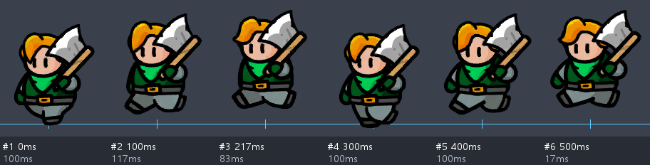

# 다른 PC용 유닛 크기·방향·모션 요약

작성 2026-10-26. **조사 원본은 work/sam_heros2**, 이 파일과 첨부 이미지는 GitHub/sam_heros로 전달한 자료다. 절대경로·localhost 없이 이 문서와 reference-hiro 폴더를 같이 가져가면 볼 수 있다.

## 1. 바로 적용할 크기

| 목적 | 캔버스 | 크기·기준점 |
|---|---|---|
| 원작과 나란히 게임 크기로 제작 | 투명 350×350px | PPU 100, pivot (0.5,0.3), 발 기준점 좌상단 기준 (175,245) |
| 히로와 비슷한 기본 인간형 초안 | 위와 동일 | 히로 Idle 첫 그림의 잘린 이미지 영역 약112×135px. 몸 높이 약135px부터 비교하되 무기는 별도 판단 |
| 현재 삼국지 승인 원화/이동 작업 | 투명400×440px | 발바닥 y≈400, 중심 x≈200. 실제 몸 높이 약290~310px. 원작 게임 크기와 동일한 px 규격이 아님 |
| 기존 관우 전투 작업 셀 | 투명640×600px | 기존400×440 그림을 축소하지 않고 여백 확장, 발 기준(320,520) |

원작 영웅86종+용병8종의 Idle 첫 프레임94개를 조사했다. 350×350 셀이90개, 나머지는500/540/600 셀이다. 모두 PPU100. 잘린 이미지 사각형(rect)의 평균은 약156×160px, 중앙값은 약150×152px다. **이 수치는 무기·모자·장식을 포함하므로 몸통/키 평균이 아니다.** 히로같은 인간형은135px 높이를 출발점으로 삼고 같은 배율로 비교하는 편이 좋다. 모든 캐릭터를 전체 bbox 높이160으로 강제하면 긴 창 캐릭터의 몸이 작아진다.

제작용400×440을 그대로 PPU100/pivot(0.5,0.3)으로 게임에 넣으면 원작보다 커지고 발 위치도 틀어진다. 400×440에서 발 기준(200,400)의 pivot은 (0.5,0.090909), 640×600에서(320,520)은 (0.5,0.133333)이다. 게임용350 셀로 납품할 때는 몸 크기와 기준점을 맞춰 별도로 정규화한다. 약300px 몸을135px로 줄이는 배율은 약0.45지만, 확정 그림을 보고 한 번 정한 배율을 모든 동작에 공통 사용한다. 프레임마다 자동 bbox 맞춤 금지.

## 2. 바라보는 방향

- 원작 엔진의 기본 스프라이트는 **왼쪽 기준**이다. 반대 방향은 화면 전체 좌우 반전으로 처리한다. 근거: web/src/packs/samguk.js의 artFlip, web/src/maker/motion.js.
- 현재 승인된 삼국지400×440 원화·이동은 **우하향3/4 시점**이다. 이 제작 기준을 이어갈지 원작 왼쪽 기준으로 새로 만들지 먼저 정한다.
- 오른쪽을 보는 그림을 현 엔진에 등록할 경우 art.facing="right"가 반전 보정에 사용된다. 왼쪽 기본 그림에는 넣지 않는다. 실제 이미지를 확인한 뒤 설정한다.
- 얼굴·몸통·양발·무기는 같은 진행 방향. 무기 날만 고치는 요청을 캐릭터 전체 반전으로 처리하지 않는다. 무기 자체 축 기준의 날 방향과 화면상 좌우를 구분한다.

## 3. 원작 모션은 몇 장인가

아래는 원작 추출 데이터의 **몸 스프라이트 트랙 키 개수**다. 같은 그림을 다시 참조한 키도 포함한다. 게임의 FPS나 새로 그려야 할 고유 그림 수와 다르다. 기본 이름이 정확히 일치하는 클립만 조사했으며 스킨·보스·시험·변형 스킬은 제외했다. 스킬은 모든 영웅에 같은 수가 있지 않다.

| 상태 | 조사 클립 수 | 키 수 중앙값 | 흔한 키 수 | 히로 키 / 고유 그림 수 | 히로 전체 시간 |
|---|---:|---:|---|---:|---:|
| Idle | 94 | 5 | 5장(77개), 4장(14개), 87장(1개) | 5 / 4 | 350ms |
| Move | 94 | 7 | 7장(61개), 5장(15개), 6장(11개) | 6 / 6 | 517ms |
| Attack | 94 | 10 | 8장(16개), 10장(14개), 9장(12개) | 12 / 11 | 900ms |
| Skill_01 | 89 | 13 | 11장(10개), 10장(10개), 13장(8개) | 11 / 10 | 850ms |
| Skill_02 | 73 | 13 | 9장(10개), 12장(9개), 10장(8개) | 12 / 11 | 1217ms |
| Gather | 94 | 9 | 9장(63개), 10장(31개) | 9 / 9 | 767ms |
| Die | 94 | 1 | 1장(94개) | 1 / 1 | 17ms |

Idle=숨쉬기, Move=이동, Attack=기본 공격, Skill_01/02=스킬1/2, Gather=채집, Die=사망. 일부 영웅에는 Skill_03 및 별도 변형 스킬이 있다. 사망1키·17ms는 정지 그림을 등록한 클립 길이이며 화면에서17ms만 보이라는 의미가 아니다. 스킬의 긴 트랙에는 반복·연출 등이 있어 중앙값만으로 새 동작 장수를 강제하지 않는다.

히로 Move는 **6키, 약516.7ms(반올림517ms)**. 기존 대화의520ms는 근사 제작값이다. 각 구간은100 / 116.7 / 83.3 / 100 / 100 / 16.7ms이며 동일 간격이 아니다. 히로 Idle은5키·350ms. 새로 그리는 장수도 반드시 같은 장수여야 하는 것은 아니다.

현재 삼국지 승인 파일의 제작값은 별개다: 숨쉬기4장×300ms=1200ms, 이동6장×100ms=600ms. 유비 공격·스킬은각8장으로 승인되었다. 과거500ms 숨쉬기/520ms 이동 요청과 최신 승인 파일을 혼용하지 않는다. 관우 전투는 반려·중단 상태이며8장 또는7장을 최종 확정 규격으로 사용하지 않는다.

새 인간형의 초안 권장값: 숨쉬기4~5장, 이동6장, 기본공격6~8장, 스킬8~12장. **이 권장값은 제작 제안이며 원작 평균 규칙이나 승인값이 아니다.** 준비→타격→회복이 읽히는 최소 장수로 만들고 타격 이벤트 시간과 프레임별 시간을 별도로 기록한다. 프레임 수×고정100ms로 모든 동작을 강제하지 않는다.

## 4. 그림·연결 검수 기준

- 큰 머리, 짧고 통통한 하체, 단순한 명암, 굵은 검은 윤곽선. 발만 움직이지 않고 허벅지부터 신발까지 자연스럽게 교대한다.
- 얼굴·몸통·손·무기의 크기와 모양은 원화에 고정. 창 길이를 프레임마다 임의로 늘이거나 줄이지 않는다. 긴 무기/효과 때문에 몸을 축소하지 말고 여백을 늘린다.
- 이동: 좌우 디딤 교대, 착지발 바닥 접지, 짧은 다리, 자연스러운 상하 바운스. 지면을 미끄러지거나 무릎이 반대로 꺾이지 않게 한다.
- 숨쉬기: 신발 고정. 벨트 포함 상체·머리·팔이 같은 리듬으로 움직임. 지면에 짚은 무기와 쥔 주먹은 고정. 손목 연결부·옷 아래 경계에 점/틈/이중선이 없는지 확대 검수.
- 공격: 칼날이 공격 진행방향을 향하고 자루는 직선. 손은 봉 위에서 제대로 쥐며 얼굴·수염과 뒤엉키지 않는다. 단일 베기는 두 번째 잔상으로 이중 공격처럼 보이지 않게 한다.
- 효과는 가능한 별도 투명 이미지로 제작하여 몸과 분리 재생. 효과로 무기/손의 오류를 숨기지 않는다.
- 정상 속도, 느린 속도, 한 장씩, 원화와 같은 배율 비교를 모두 확인한다. 원본 덮어쓰기·미승인본 자동 승격 금지.

## 5. 히로 이동 예시

work/sam_heros2/samguk/references/original-motion/Hero_01/Move.png를 **수정 없이 복사**한 원작 동작 참고 시트다. 파란 선은 발 기준선. 그림은 보기 편하게 공통 영역으로 잘라 배치되어 있으므로 시트의 한 칸 너비를 원본350px 캔버스 크기로 오해하지 않는다. 원작 그림을 삼국지 완성 이미지로 사용하지 않는다.

## 6. 다른 PC 인수인계

1. 이 문서와 reference-hiro/Hero_01-Move.png, ORIGINAL_UNIT_REFERENCE_DATA.json을 함께 가져간다.
2. 기존 승인 장수 original/idle/run 및 docs/motion-guide의 명세를 확인한다. 원작350 규격과 제작400 규격을 분리한다.
3. 관우: 2026-10-26 work에서 만든 공격·스킬 수정안은 사용자 요청으로 폐기·중단했다. v4/v3-refined 등 실패안을 기준으로 복구하지 않는다. GitHub에 남아 있는 관우 전투 파일도 승인본으로 간주하지 않는다. 다음 지시에서 새로 시작한다.
4. GitHub 저장소 AGENTS.md에 기존 병합 충돌 표식과 서로 다른 시점의 규칙이 남아 있다. 이 문서는 그 파일을 자동 병합하지 않았다. 최신 사용자 결정과 실제 승인 PNG를 우선 확인한다.
5. 이 작업은 로컬 GitHub 폴더에 파일을 저장한 것이다. 다른 PC에서 git pull로 받으려면 이 파일들을 커밋·푸시해야 한다. 자동 푸시는 하지 않았다.

### 조사 근거

- work/sam_heros2/re/extract/media/anims.json, sprites.json: 원작 클립·치수·pivot·PPU.
- work/sam_heros2/tools/scripts/export_motion_refs.py: 가장 긴 스프라이트 트랙 및 참고 시트 생성 방식.
- work/sam_heros2/web/src/packs/samguk.js, web/src/maker/motion.js: 방향 처리.
- work/sam_heros2/samguk/docs/motion-guide/CHARACTER_GENERATION_SPEC.md 및 각 장수 animation.json: 현재 제작 규격.
- [수치 요약 JSON](ORIGINAL_UNIT_REFERENCE_DATA.json): 히로 고유 그림 수, 프레임별 시간, 이벤트와 원작 표본 통계.
