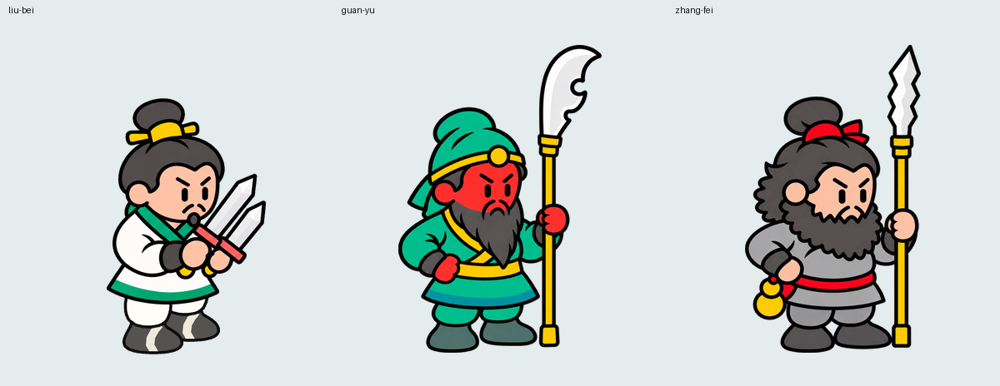
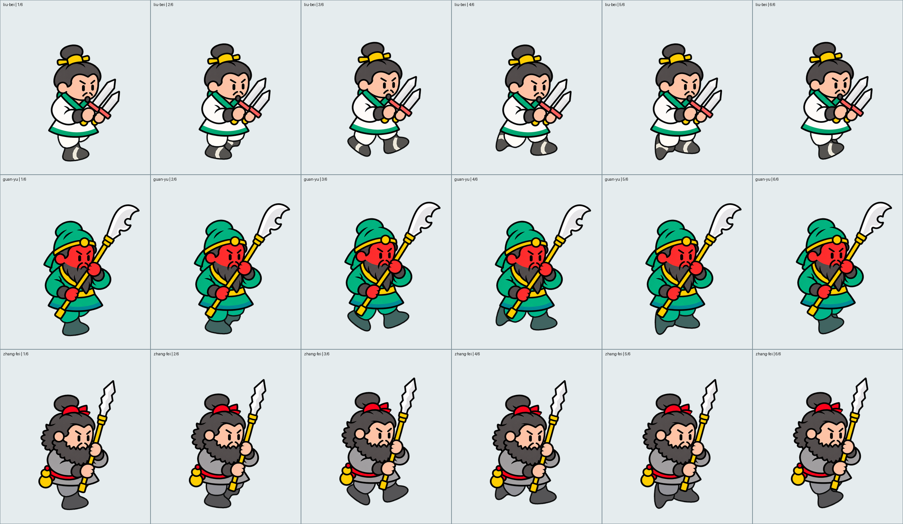
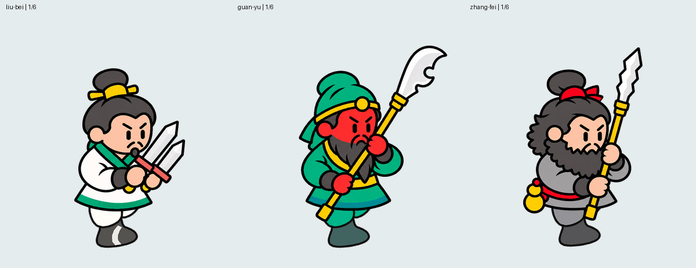
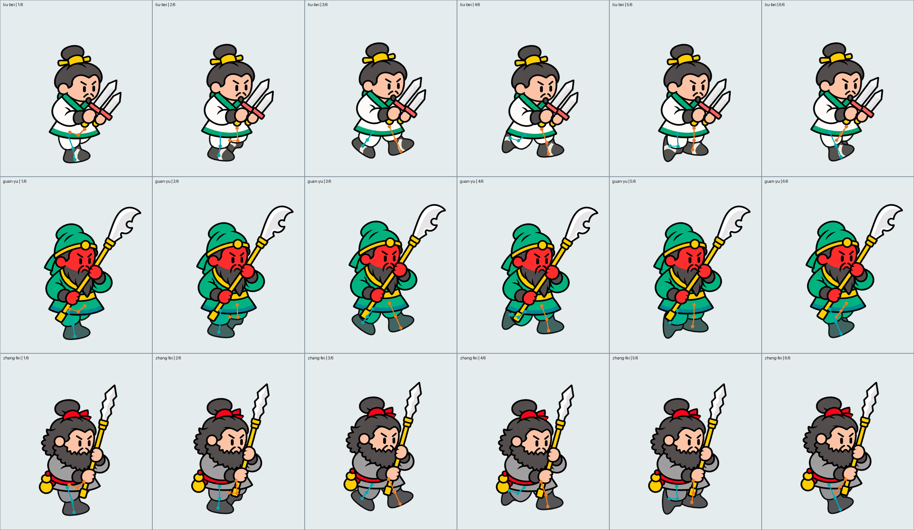
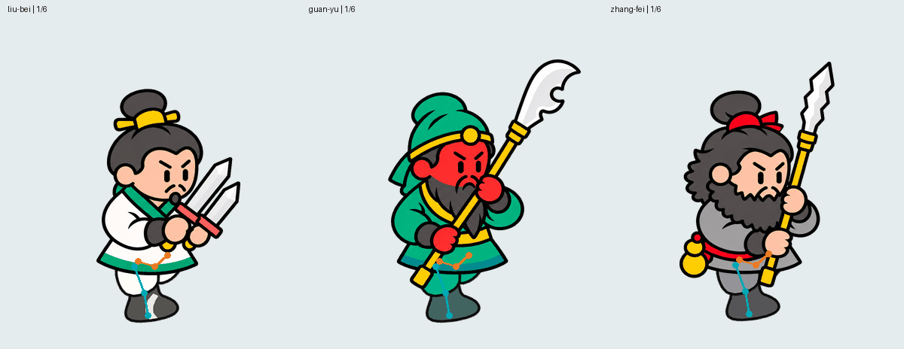
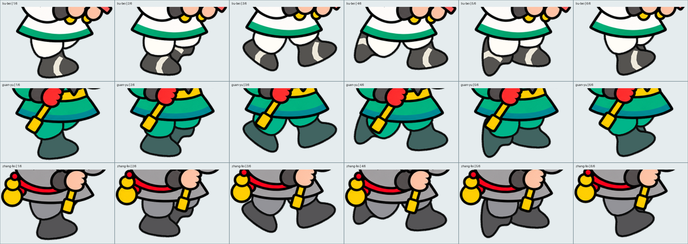
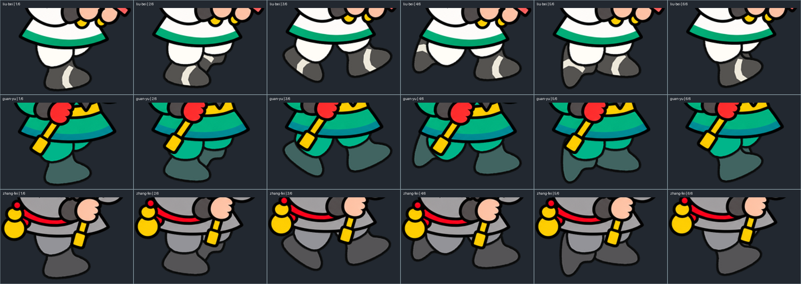

# 장수 모션 제작 기준

기록일: 2026-10-26. 다음 세션에서 다른 장수를 만들 때 먼저 읽는 문서다. **승인된 유비·관우·장비의 오른쪽 아래 대각 이동 6프레임**을 재사용 가능한 기준으로 기록한다. 새 모션이나 원작 게임에서 추출한 데이터가 아니다.

## 읽는 순서

1. 이 문서의 그림과 GIF를 실제로 열어 본다.
2. [외형·관절·프레임 명세](run-spec.md)를 읽는다.
3. [다음 장수 제작 순서와 검수](workflow.md)를 따른다.
4. 좌표·곡선의 정확한 구현은 [재현 코드](../../tools/character-motion/render.py), [18프레임 관절 좌표](../../tools/character-motion/joint-data.json)를 확인한다.

## 반드시 볼 그림

### 최종 기본자세 — 관우·장비는 한 손, 무기 끝은 지면

### 최종 이동 — 행: 유비 / 관우 / 장비, 열: 1~6

[느린 반복 보기](visuals/approved-run-slow.gif). 정상 100ms/프레임, 느린 검수 240ms/프레임이다. GIF 배경은 검수용이며 게임용 PNG는 투명하다.

### 관절 확인용 — 청록 L / 주황 R

색은 캐릭터 해부학적 좌우를 구분한다. 화면 왼쪽/오른쪽과 혼동하지 않는다. 관절 표시는 설명용으로 최종 아트에 포함하지 않는다. 실제 발끝 윤곽과 관절 끝 좌표는 일치하지 않는다.

### 하체 연결·윤곽 확대

## 기준 우선순위와 보관

- 외형/움직임의 최종 기준: 루트의 [유비](../../liu-bei/README.md), [관우](../../guan-yu/README.md), [장비](../../zhang-fei/README.md)의 `idle`/`run` PNG와 GIF.
- 구현 기준: `tools/character-motion/render.py`, 상체 원본 `parts-atlas.png`, 별도 기본자세 원본 `idle-sources`.
- 이 폴더의 그림은 최종 파일로 만든 설명용 모음이다. 최종 원본을 대체하지 않는다. [파일 지문 기록](source-manifest.json)으로 어느 원본에서 만들었는지 확인한다.
- 전체 미술 기준: [디자인 가이드](../DESIGN_GUIDE.md). 원작 자료는 [출처 기록](../design/references/original-game/README.md)에 있다.
- 삭제한 실패 시안은 복원하지 않는다. 실패의 이유는 문서로만 남긴다.

## 다음 세션에 전달할 핵심

새 장수의 확정 원화를 먼저 확인하고 이 폴더의 실제 GIF를 재생한다. 큰 머리와 짧고 통통한 하체, 우하향 투영, 좌우 3프레임 위상차를 적용한다. 기존 상체와 무기는 고정된 한 덩어리로 유지하고 하체는 닫힌 곡선으로 만든다. 신발색·복식·얼굴·무기는 각 장수 고유 디자인을 유지한다. 정지 자세와 달리는 무기 파지를 혼동하지 않는다. 새 장수는 별도 영어 폴더에서 검토하고 승인 전 기존 최종본을 덮어쓰지 않는다.

이 기준은 이동용이다. 공격·스킬의 발동 조건, 타격 시점, 범위, 피해 수치나 이펙트는 여기서 추론하지 않는다. 다른 모션은 사용자가 지정한 종류와 별도 근거에 따라 설계한다.

## 추가 작업: 숨쉬기

[4프레임 숨쉬기 최종 승인본](idle-breathing.md)에 원본 보관 위치, 고정영역, 재생 화면과 검증을 기록했다. 이동 승인 기준과 구분한다.

## 유비 공격·스킬 최종 승인

[유비 기본 공격·스킬1·스킬2](liu-bei-combat.md): 2026-10-26 사용자가 확정한 각8프레임 동작. 이동·숨쉬기와 함께 유비의 최종 모션 기준으로 보존한다.

## 관우 공격·스킬 검토본

[관우 공격·스킬 명세](guan-yu-combat.md): 각8프레임, 스킬1은 대각 두 번 베기와 X자 잔상. 사용자 승인 전이다.

- 다음 PC/세션에서 장수·모션 제작 전 [작업 이어가기](COMBAT_HANDOFF.md)와 [새 장수 생성 조건](CHARACTER_GENERATION_SPEC.md)을 읽는다. 머리·몸통·다리 width/height, 관절·파지·칼날 방향과 승인 상태를 확인한다.
