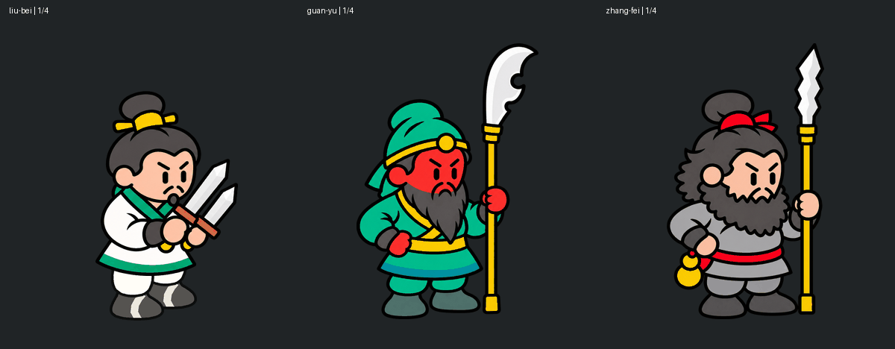

# 4프레임 숨쉬기 — 최종 승인본

2026-10-26 사용자 요청으로 제작. 2026-10-26 사용자가 최종 승인했다. 이동과 함께 다음 장수의 제작 기준으로 사용한다.

[12프레임 전체 보기](visuals/idle-breathing-12-frames.png) · [재생 화면](idle-preview.html)

## 동작 규칙

- 원본 정지 PNG는 각 장수의 `original/original.png`에 바이트 그대로 보존했다.
- 상체 높이: 1번0px → 2번-2px → 3번-4px → 4번-2px → 다음1번0px. 한 주기 한 번 상승·하강한다.
- 프레임당300ms, 한 주기1.2초. 이는 이번 제작 선택이며 원작 측정값이 아니다.
- 하반신은 고정한다. 관우·장비는 칼날·자루·지면에 닿는 끝과 무기를 쥔 주먹도 고정한다.
- 유비는 지면을 짚는 무기가 없으므로 쌍검과 두 손이 상체와 함께 호흡한다.
- 몸통의 상하 이동이 고정 손목과 하반신에 연결되도록 소매/도포 연결 구간에서 변위를 부드럽게 줄인다. 관절 경계에서 이미지를 잘라 따로 움직이지 않는다.
- 완전 강체로 상체를 통째로 올리면 고정된 손과 다리에서 틈이 생기므로, 얼굴·머리 중심의 이동을 유지하면서 연결부만 작은 연속 변형을 적용한다.

## 데이터와 재현

각 장수의 `idle`에 투명PNG4장, 1600×440 시트, 프레임 보기, GIF, animation.json을 저장했다. 기존 `idle.png`는 정지 미리보기 호환용이며 숨쉬기를 표시하려면 animation.json의4장을 순서대로 사용한다.

[render_idle.py](../../tools/character-motion/render_idle.py)는 보존된 original을 읽는다. [고정영역 검증](idle-verification.json)은 원본 해시와 고정 픽셀의 동일 여부를 기록한다. 프레임1은 원본과 동일하다. 기존 run 파일은 변경하지 않는다.

재현 명령: 프로젝트 루트에서 `python tools/character-motion/render_idle.py`. 400×440용 고정영역 좌표는 다른 원화에 자동 적용하지 않는다. 새 장수의 무기와 주먹 경계를 따로 확인해야 한다.

## 프레임별 기준

좌상단이 (0,0)이며 y가 작아질수록 위로 올라간다. 아래 변위는 자유롭게 움직이는 상체 영역의 값이다. 연결부는 그보다 작게 움직이고 고정부는 0이다.

| 프레임 | 시간 | 상체 y 변위 | 역할 |
|---|---|---:|---|
| 1 | 0~300ms | 0px | 원본 기본 높이 |
| 2 | 300~600ms | -2px | 상승 중간 |
| 3 | 600~900ms | -4px | 최고점 |
| 4 | 900~1200ms | -2px | 하강 중간 |
| 다음 1 | 1200ms부터 | 0px | 원래 높이로 복귀, 반복 |

1번을 끝에 추가한5프레임으로 만들지 않는다. 2번과4번의 높이가 같은 것은 의도된 대칭 호흡이다. 다리 교대, 발 들기, 무기 흔들림, 별도 두 번째 바운스는 넣지 않는다.

## 고정 영역과 연결부의 정확한 설정

아래 값은 승인된400×440 이미지에서의 픽셀 좌표다. 원본 고해상도 파일이나 다른 장수에 그대로 복사하지 않는다.

| 항목 | 유비 | 관우 | 장비 |
|---|---:|---:|---:|
| 도포 연결부 변위 감소 시작 y | 302 | 302 | 309 |
| 이 y 이상 완전 고정 | 338 | 343 | 345 |
| 무기 방향 고정 시작 x | 해당 없음 | 249 | 273 |
| 쥔 주먹 중심 (x,y) | 해당 없음 | (263,240) | (284,248) |
| 주먹 완전 고정 반경 | 해당 없음 | 22px | 23px |
| 넓은 칼날 추가 고정 | 해당 없음 | y<180, x≥238 | y<180, x≥258 |

관우·장비는 무기 고정 x의 왼쪽18px 구간에서 이동량을 서서히 줄인다. 주먹 고정 반경 바깥22px에서도 이동량을 서서히 늘린다. 따라서 손목·소매가 끊어지지 않으면서 주먹과 무기는 제자리를 지킨다. 넓은 칼날은 자루보다 왼쪽으로 돌출하므로 추가 고정 영역이 필요하다.

연결부의 보간은 `smooth(t)=t²(3−2t)`이며 t를0~1로 제한한다. 세로 연결, 무기 주변, 주먹 주변의 가중치를 곱해 최종 이동량을 정한다. 얼굴·모자 중심은 원형을 유지한 채 위아래로 이동하고 연결부만 미세하게 변형된다.

렌더링은 원본을 연속적으로 좌표 변환한다. 알파를 곱한 색으로 보간해 투명 가장자리의 흰 테두리를 줄이고, 완전 고정 영역에는 원본 RGBA를 그대로 복원한다. 원본에서 조각을 지워 빈 곳을 만드는 방식이 아니다.

## 다음 장수에 적용하는 순서

1. 확정 정지 원화를 `장수영문명/original/original.png`에 보존한다. 기존 승인 원본을 덮어쓰지 않는다.
2. 이 문서의 GIF와12프레임 시트를 직접 보고 작은 호흡 크기를 확인한다.
3. 하반신 경계, 움직일 상체, 고정할 손과 무기를 표시한다. 지면을 짚는 무기는 칼날부터 끝까지 고정한다. 공중에 든 무기는 유비처럼 상체와 함께 움직일 수 있으나 해당 장수의 자세에 맞게 정한다.
4. 현재 원화 크기에 맞춰 연결부와 고정영역을 설정한다. 무기 장식·칼날·손가락 끝이 고정영역 밖으로 빠지지 않게 확인한다.
5. 0/-2/-4/-2px, 300ms를 기본으로4장을 만든다. 셀이 달라지면 진폭의 상대 크기를 비교하고, 무조건4px만 복사하지 않는다.
6. 새 장수 폴더에서 GIF와 투명PNG를 검토한다. 사용자 승인 전에는 공통 기준이나 기존 장수 최종본을 교체하지 않는다.

## 검수와 최종 보존

- [ ] 하반신이4장 모두 원본과 픽셀 동일하다. 발바닥이 떠오르거나 좌우로 흔들리지 않는다.
- [ ] 지면을 짚는 무기와 쥔 주먹이4장 모두 원본과 픽셀 동일하다. 칼날 돌출부까지 확인한다.
- [ ] 머리·상체는 한 주기에 한 번 오르내리고 4→1도 자연스럽다.
- [ ] 소매·손목·도포 연결에 빈틈, 잔선, 잘린 윤곽, 흰 테두리가 없다. 밝고 어두운 배경에서 확인한다.
- [ ] 얼굴·수염·모자·복식의 색과 형태가 유지된다. 원화를 프레임마다 새로 그려 외형이 바뀌지 않는다.
- [ ] 투명PNG400×440 4장, 시트1600×440, GIF4장×300ms, 무한반복 설정이 맞다.
- [ ] 원본 original과 기존 이동 run은 그대로 보존된다.

현재 승인본의 파일 지문은 [idle-checksums.json](../../tools/character-motion/idle-checksums.json)에 있다. 제작 코드 실행은 idle 산출물을 다시 쓰므로 참고만 할 때 실행하지 않는다. 다음 장수는 새 대상으로 분리해 제작한다.
